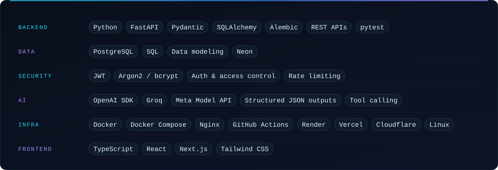
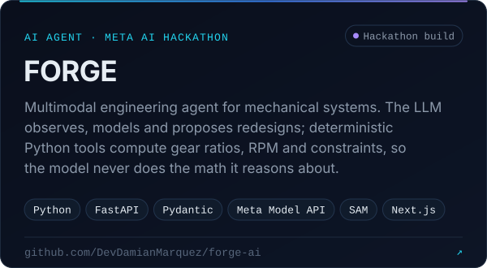
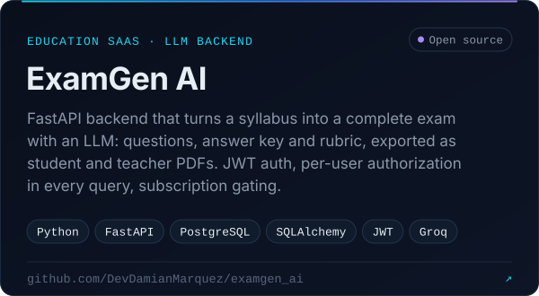
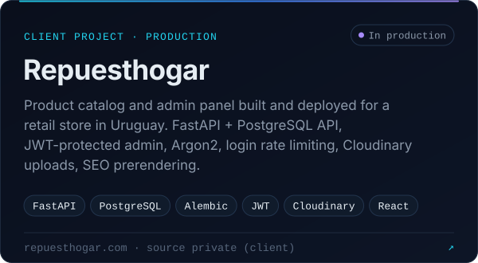
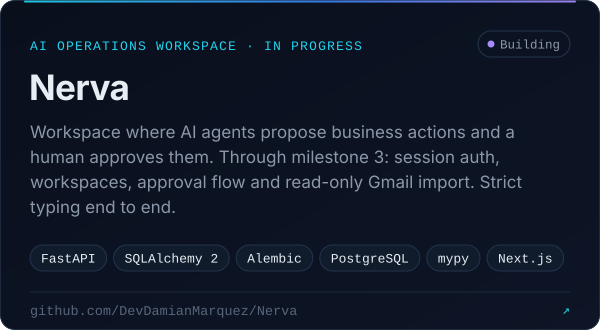
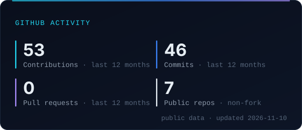
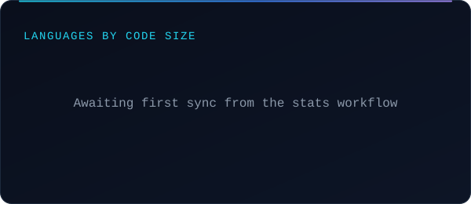
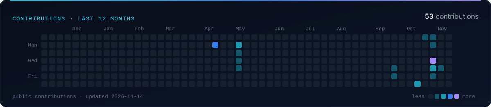

<!--
  Profile README for github.com/DevDamianMarquez.
  Images are generated SVGs with a dark and a light variant:
    - edit profile.json, then run `python scripts/build_assets.py`
    - activity cards are refreshed daily by .github/workflows/profile-assets.yml
  See scripts/README.md for details.
-->

<a href="https://damian-backend-portfolio.vercel.app">
  <picture>
    <source media="(prefers-color-scheme: dark)" srcset="./assets/static/hero-dark.svg">
    <source media="(prefers-color-scheme: light)" srcset="./assets/static/hero-light.svg">
    
  </picture>
</a>

<picture>
  <source media="(prefers-color-scheme: dark)" srcset="./assets/static/headline-dark.svg">
  <source media="(prefers-color-scheme: light)" srcset="./assets/static/headline-light.svg">
  
</picture>

## About

I'm a backend developer from Uruguay. I build APIs end to end: the data model, authentication and authorization, the business logic, the tests, and the deployment. My daily tools are **Python, FastAPI, PostgreSQL and SQLAlchemy**, packaged with **Docker**.

I'm increasingly focused on **AI engineering**: putting LLMs inside real software with clear boundaries. That means structured JSON outputs, deterministic code for anything that must be correct, and tests around the parts a model touches.

Recently I built and deployed a catalog platform for a retail client, wrote an LLM-backed exam generation API, and built FORGE for the Meta Global AI Developer Hackathon: an engineering agent whose physics is computed by Python, not by the model.

<table>
  <tr>
    <td><b>Focus</b></td>
    <td>Backend engineering · API design · data modeling · auth · LLM integrations</td>
  </tr>
  <tr>
    <td><b>Building</b></td>
    <td><a href="https://github.com/DevDamianMarquez/Nerva">Nerva</a>, a workspace designed for AI agents that propose business actions for a human to approve (agent layer in progress)</td>
  </tr>
  <tr>
    <td><b>Looking for</b></td>
    <td>Backend roles, remote, in Latin America or with international teams</td>
  </tr>
  <tr>
    <td><b>Languages</b></td>
    <td>Spanish (native) · English (professional, written)</td>
  </tr>
</table>

## Tech stack

<picture>
  <source media="(prefers-color-scheme: dark)" srcset="./assets/static/stack-dark.svg">
  <source media="(prefers-color-scheme: light)" srcset="./assets/static/stack-light.svg">
  
</picture>

## Featured projects

  <a href="https://github.com/DevDamianMarquez/forge-ai">
    <picture>
      <source media="(prefers-color-scheme: dark)" srcset="./assets/static/project-forge-dark.svg">
      <source media="(prefers-color-scheme: light)" srcset="./assets/static/project-forge-light.svg">
      
    </picture>
  </a>
  <a href="https://github.com/DevDamianMarquez/examgen_ai">
    <picture>
      <source media="(prefers-color-scheme: dark)" srcset="./assets/static/project-examgen-dark.svg">
      <source media="(prefers-color-scheme: light)" srcset="./assets/static/project-examgen-light.svg">
      
    </picture>
  </a>
  <a href="https://repuesthogar.com">
    <picture>
      <source media="(prefers-color-scheme: dark)" srcset="./assets/static/project-repuesthogar-dark.svg">
      <source media="(prefers-color-scheme: light)" srcset="./assets/static/project-repuesthogar-light.svg">
      
    </picture>
  </a>
  <a href="https://github.com/DevDamianMarquez/Nerva">
    <picture>
      <source media="(prefers-color-scheme: dark)" srcset="./assets/static/project-nerva-dark.svg">
      <source media="(prefers-color-scheme: light)" srcset="./assets/static/project-nerva-light.svg">
      
    </picture>
  </a>

| Project | Code | Live / details |
| :-- | :-- | :-- |
| **FORGE** | [forge-ai](https://github.com/DevDamianMarquez/forge-ai) | [Demo](https://forge-ai-phi-nine.vercel.app) |
| **ExamGen AI** | [examgen_ai](https://github.com/DevDamianMarquez/examgen_ai) | [Case study](https://damian-backend-portfolio.vercel.app/projects/examgen-ai) |
| **Repuesthogar** | Private (client project) | [repuesthogar.com](https://repuesthogar.com) · [Case study](https://damian-backend-portfolio.vercel.app/projects/repuesthogar) |
| **Nerva** | [Nerva](https://github.com/DevDamianMarquez/Nerva) | In development |

## GitHub activity

  <picture>
    <source media="(prefers-color-scheme: dark)" srcset="./assets/generated/overview-dark.svg">
    <source media="(prefers-color-scheme: light)" srcset="./assets/generated/overview-light.svg">
    
  </picture>
  <picture>
    <source media="(prefers-color-scheme: dark)" srcset="./assets/generated/languages-dark.svg">
    <source media="(prefers-color-scheme: light)" srcset="./assets/generated/languages-light.svg">
    
  </picture>
  <picture>
    <source media="(prefers-color-scheme: dark)" srcset="./assets/generated/contributions-dark.svg">
    <source media="(prefers-color-scheme: light)" srcset="./assets/generated/contributions-light.svg">
    
  </picture>

Generated daily from the public GitHub API by <a href="./.github/workflows/profile-assets.yml">a workflow in this repo</a>. No third-party stats services.

## Get in touch

  <a href="https://damian-backend-portfolio.vercel.app"><picture><source media="(prefers-color-scheme: dark)" srcset="./assets/static/link-portfolio-dark.svg"><source media="(prefers-color-scheme: light)" srcset="./assets/static/link-portfolio-light.svg"></picture></a>&nbsp;
  <a href="https://www.linkedin.com/in/damian-marquez/"><picture><source media="(prefers-color-scheme: dark)" srcset="./assets/static/link-linkedin-dark.svg"><source media="(prefers-color-scheme: light)" srcset="./assets/static/link-linkedin-light.svg"></picture></a>&nbsp;
  <a href="mailto:marquezdamianjob@gmail.com"><picture><source media="(prefers-color-scheme: dark)" srcset="./assets/static/link-email-dark.svg"><source media="(prefers-color-scheme: light)" srcset="./assets/static/link-email-light.svg"></picture></a>&nbsp;
  <a href="https://damian-backend-portfolio.vercel.app/cv.pdf"><picture><source media="(prefers-color-scheme: dark)" srcset="./assets/static/link-resume-dark.svg"><source media="(prefers-color-scheme: light)" srcset="./assets/static/link-resume-light.svg"></picture></a>

  <picture>
    <source media="(prefers-color-scheme: dark)" srcset="./assets/static/footer-dark.svg">
    <source media="(prefers-color-scheme: light)" srcset="./assets/static/footer-light.svg">
    
  </picture>

